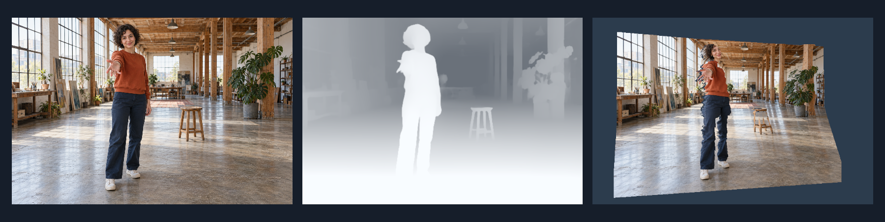
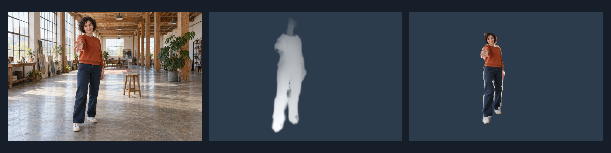

# Depth Anything V2 for Unity

Turn an image, video texture or webcam frame into a GPU depth texture using **Depth Anything V2 Small** and Unity's **Inference Engine / Sentis 2.6.1**.



Left to right: source photograph, estimated depth, displaced mesh. These are the included demo's actual GPU render targets, captured offscreen. The source photograph is AI-generated; the depth and relief are computed by the shipped model. No Python service, native inference plugin or CUDA installation is needed at runtime.

## Quick start

1. Open this repository folder as a Unity project in **Unity 6000.6.3f1** (the tested editor).
2. Let Unity resolve packages and import the included ONNX model. The first import can take a while.
3. Open **`Assets/DepthDemo/DepthDemo.unity`** and press Play.
4. Adjust quality, relief and orbit. Enable **Use webcam** to switch inputs, or assign your own `Texture2D` to **Sample Image**. A prepared `VideoPlayer` can also be assigned; its texture and frame index are used automatically.

The sample photo is included at [`Assets/DepthDemo/Studio.png`](Assets/DepthDemo/Studio.png). Camera hardware is only accessed when the webcam toggle is enabled.

## Install only the package

In another Unity project, choose **Window > Package Management > Package Manager > + > Install package from disk**, then select:

```text
Packages/com.vass.depth-anything/package.json
```

Keep that package folder in a durable location. Alternatively, copy the entire `com.vass.depth-anything` directory into your project's `Packages` directory as an embedded package. The core has one declared dependency: `com.unity.ai.inference` version `2.6.1`.

After this repository is published, Git installation can use its clone URL followed by `?path=/Packages/com.vass.depth-anything`. No hosted repository URL is assumed in this distribution.

Import **Basic** from the package's **Samples** tab, then open the imported `DepthDemo.unity`. The samples use Unity's standard IMGUI, video and image-conversion modules. They are included in ordinary Unity templates and in this repository's manifest.

## API

```csharp
using DepthAnything;
using UnityEngine;

public sealed class MyDepthInput : MonoBehaviour
{
    public Texture source;
    DepthEstimator estimator;

    void OnEnable() => estimator = new DepthEstimator();

    void Update()
    {
        estimator.Process(source, DepthEstimator.Quality.Fast);
        RenderTexture rawDepth = estimator.DepthTexture;
        // null until the first estimate completes; pass it to your own shader.
    }

    void OnDisable() => estimator?.Dispose();
}
```

- **Input:** an RGB Unity `Texture`. Preprocessing converts sampled colors back to sRGB when needed, applies ImageNet normalization, and resizes to a 14-pixel patch grid.
- **Output:** a borrowed `RHalf` texture. Red contains **relative inverse depth**: larger values are nearer. Values are neither meters nor restricted to 0–1. Do not dispose the texture yourself; it may be replaced when the input grid changes.
- **Scheduling:** call `Process` once per rendered frame, including frames with no new input. Cold inference schedules at most 128 iterator steps per call. Warm inference targets roughly three calls per estimate, capped at 192 steps. These are scheduling limits, not GPU-time guarantees.
- **Freshness:** for a video or other producer, pass its increasing frame version as the third argument. A `Texture2D` defaults to `updateCount`; other texture types with no explicit version are processed continuously. GPU edits to a `Texture2D` need an explicit producer version or `IncrementUpdateCount()`.
- **State:** `Revision` counts completed estimates, `StartedRun` identifies the tick when the input was captured, and `HasError` / `Status` report failures. `Reset()` clears a failure and pending work. `Dispose()` releases owned GPU resources.
- **Threading:** create, process and dispose on Unity's main thread.

The default constructor loads the pinned model bundled with the package. `new DepthEstimator(modelAsset)` accepts a compatible export with the same input and output contract; it is not a universal depth-model loader.

### Normalization and masks

```csharp
var post = new DepthPostProcessor(); // create once
post.Process(estimator.DepthTexture, deltaTime: Time.deltaTime);
RenderTexture normalized = post.Texture; // R: 0..1, near=1; G: coverage
// Dispose post when its owner is disabled or destroyed.
```

The normalizer uses mean ± 2 standard deviations, with optional smoothing of the range. It keeps statistics and output on the GPU. This is a display/relief mapping, not metric calibration or per-pixel temporal stabilization.

For a foreground mask, pass `currentMask` and `estimateMask` to `Process`. Both masks must share the depth texture's UV framing. Capture `estimateMask` when `StartedRun` becomes true and retain it until that estimate completes. The processor intersects the two masks, rejects unreliable outline depth, then fills from trusted interior pixels. It accepts masks from any segmentation provider; **BodyPix is not a core dependency**.

### Quality

| Preset | Nominal input height | Approximate 16:9 grid |
| --- | ---: | ---: |
| Fast | 308 | 546 × 308 |
| Balanced | 392 | 700 × 392 |
| Detail | 518 | 924 × 518 |

Widths are rounded to patches; grids of 24 or 48 patches are nudged to avoid a resize mismatch in the pinned ONNX export on Inference Engine 2.6.1. Extreme aspect ratios are bounded, so they can be distorted. Start with Fast for live input. Rendering FPS and inference updates per second are separate quantities.

## Optional BodyPix sample



1. Install [Keijiro's BodyPixSentis](https://github.com/keijiro/BodyPixSentis), **version 5.0.0**. Add the scoped registry `https://registry.npmjs.org` with scopes `jp.keijiro.bodypix` and `jp.keijiro.klak.nnutils`, then install `jp.keijiro.bodypix`.
2. Import this package's **Basic** sample first (the example project already contains it).
3. Import **BodyPix**, then open the imported **`BodyPixDemo.unity`**. Its resource reference targets BodyPix's `MobileNetV1-x100-stride8` asset for a finer demo mask. You can choose a smaller resource and resolution in the Inspector for live use.
4. Press Play. The scene estimates whole-image depth, captures the matching person mask, and displays cleaned, normalized person relief.

For the included example project, **close Unity first**, then run `Tools/Enable-BodyPix.ps1` in PowerShell to add the registry/dependency and copy the optional sample. Reopen Unity and open `Assets/BodyPixDemo/BodyPixDemo.unity`. The script changes only this example project's manifest and adds that sample folder.

The adapter code and scene live under `Samples~/BodyPix`, which Unity ignores until imported. Do not import that sample before installing BodyPix, or its assembly references will be unresolved. To remove BodyPix later, remove the imported BodyPix sample first. The core and Basic sample continue to work independently.

This is a small integration example, not VASS's full segmentation/refinement or stage-rendering system. BodyPix inference itself runs as one scheduled operation; only the depth estimator is frame-sliced. The adapter retains masks from the start of each depth estimate, but fast motion can still create visible lag.

## Compatibility and limitations

- Tested target: **Windows x64, D3D11**, Unity **6000.6.3f1**, Inference Engine **2.6.1**. See [validation](Documentation/Validation.md) for executed checks.
- Requires a compute-capable GPU and float/half render textures. The core does not reference URP, HDRP or VASS. The bundled demo uses the Built-in Render Pipeline; other pipelines and graphics APIs need their own validation.
- WebGL is unsupported by this GPUCompute implementation. Mobile, macOS, Linux and physical webcam behavior have not been validated here.
- The simple webcam sample uses the camera's raw texture orientation. Applications targeting rotated or mirrored camera feeds should normalize their input framing before passing it to the estimator.
- Relative depth cannot measure distance or recover hidden surfaces. The relief sample shows a single displaced image, so large rotations reveal holes and stretched surfaces.
- Raw model output can flicker between frames. Range smoothing does not turn V2 into Video Depth Anything.
- First-time shader compilation and model allocation can be expensive even though inference scheduling is sliced.

## Model, credits and license

Unity integration, GPU processing and samples by **Ashkon Khalkhali**. Copyright (c) 2026 Ashkon Khalkhali.

The integration code, shaders, demo scenes, tools and documentation are licensed under **MIT**; see [LICENSE](LICENSE). This permission applies to this project's original work. The bundled model and external dependencies retain their own licenses, and the generated sample photograph has the separate reuse note below. The package metadata uses `MIT AND Apache-2.0` to describe the two licenses for its separate components; it is not a choice of license for the model.

Extracted and adapted from the VASS integration; no VASS runtime, scenes or settings are required.

The **unmodified V2 Small ONNX model** is included [onnx-community/depth-anything-v2-small](https://huggingface.co/onnx-community/depth-anything-v2-small), revision `4472b7362082ad9968fee890ca0f1e5aca36b93d`, file `onnx/model.onnx`.

```text
SHA-256: afb6a5c28f3b6bf1618c6e43f02073ef9dfdc70e937502d51603e57b0a1df10c
```

Depth Anything V2 is by Lihe Yang, Bingyi Kang, Zilong Huang, Zhen Zhao, Xiaogang Xu, Jiashi Feng and Hengshuang Zhao. [Original project](https://github.com/DepthAnything/Depth-Anything-V2). Small remains **Apache-2.0**; the upstream Base/Large/Giant variants have different, noncommercial terms and are not bundled. When redistributing the integration and bundled model, preserve [the MIT license](LICENSE), [the model's Apache-2.0 license](Packages/com.vass.depth-anything/ThirdParty/DepthAnything/LICENSE.txt) and the package's [Third Party Notices](Packages/com.vass.depth-anything/Third%20Party%20Notices.md).

Optional BodyPix is maintained by Keijiro Takahashi and distributed separately under its own notices. This project is not affiliated with Keijiro or the Depth Anything authors.

The sample photograph was generated for this repository. Its provenance and exact prompt are in [Sample Image](Documentation/SampleImage.md). The original model is stored as a normal Git binary below GitHub's per-file size limit; no Git LFS setup is required. A package release may also be distributed as a `.tgz`.

## Reproduce validation and package a release

With Unity closed, run `Tools/Validate.ps1` in PowerShell. It builds and runs the Basic Windows player, writes checks under `Validation/basic`, and captures actual depth/relief textures. After enabling the BodyPix sample, use `Tools/Validate.ps1 -BodyPix`. Supply `-Unity` if the Editor is installed elsewhere. The smoke runner never opens a webcam automatically.

`Tools/Pack.ps1` creates `Releases/com.vass.depth-anything-0.1.1.tgz` for Package Manager's **Install package from tarball**. `Tools/Export-Source.ps1` creates the complete example project ZIP using the same package version. Bump the version or move an earlier archive aside before creating another release.
