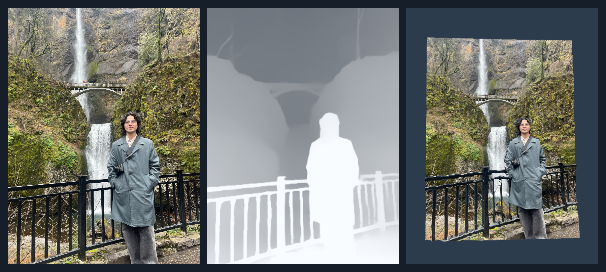
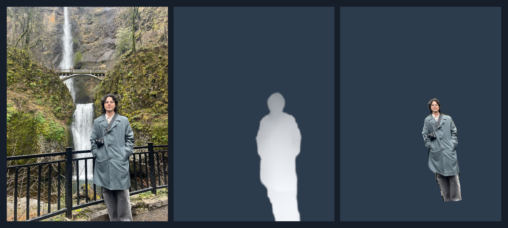

# DepthAnythingSentis



**DepthAnythingSentis** estimates depth from images, video and webcam input using
[Depth Anything V2](https://github.com/DepthAnything/Depth-Anything-V2). It runs on
[Sentis](https://docs.unity3d.com/Packages/com.unity.ai.inference@latest), Unity's
neural network runtime, and returns a depth texture on the GPU.

## Requirements

- Unity 6.0 or newer
- GPU with compute shader support

GPU inference only. WebGL is not supported. The samples use the Built-in Render
Pipeline and have been tested on Windows with Direct3D 11.

## Installation

In Unity's Package Manager, choose **Install package from Git URL** and enter:

```text
https://github.com/ashkonk/DepthAnythingSentis.git?path=/Packages/com.vass.depth-anything
```

Sentis 2.6.1 and the Depth Anything V2 Small model are included automatically.

## Samples

Open this repository as a Unity project, then open
[`Assets/DepthDemo/DepthDemo.unity`](Assets/DepthDemo/DepthDemo.unity) and press Play.
If you installed only the package, import **Basic** from its **Samples** tab.

The demo shows the input image, depth map and a displaced mesh. Use **Sample Image**
to choose a photo, **Use webcam** for live input, or assign a prepared `VideoPlayer`.
The on-screen controls adjust quality, mesh depth and viewing angle.

### Optional BodyPix integration



1. Install [BodyPixSentis 5.0.0](https://github.com/keijiro/BodyPixSentis#installation)
   using Keijiro's scoped registry.
2. Import this package's **Basic** sample if it is not already in your project,
   then import **BodyPix**.
3. Open the imported `BodyPixDemo.unity` and press Play.

This sample uses BodyPix to isolate the person before displaying their depth.
BodyPix is optional; the main package works without it.

## API Usage

```csharp
// Create once.
var estimator = new DepthAnything.DepthEstimator();

// Call each frame. Inference is spread across frames.
estimator.Process(inputTexture);

// GPU output; null until the first estimate completes.
var depth = estimator.DepthTexture;

// Release resources when finished.
estimator.Dispose();
```

The output contains relative inverse depth: larger values are nearer. It does not
measure distance in meters. The estimator owns the output texture.

Pass `DepthEstimator.Quality.Fast`, `Balanced` or `Detail` as the second argument
to `Process` to change quality. For video, an optional third argument identifies
the source frame. `DepthPostProcessor` converts the output to a 0–1 range; see the
Basic sample for usage.

## Model

The package includes the [V2 Small ONNX model](https://huggingface.co/onnx-community/depth-anything-v2-small).
No model conversion is needed. Larger Depth Anything models are not included.
The mesh is a view of one image; rotating it can reveal gaps behind foreground objects.

## Credits and License

Unity integration by **Ashkon Khalkhali**. Code is licensed under [MIT](LICENSE).
The included model is licensed under [Apache-2.0](Packages/com.vass.depth-anything/ThirdParty/DepthAnything/LICENSE.txt).
See [Third Party Notices](Packages/com.vass.depth-anything/Third%20Party%20Notices.md)
for model credits and separate photo usage terms.
